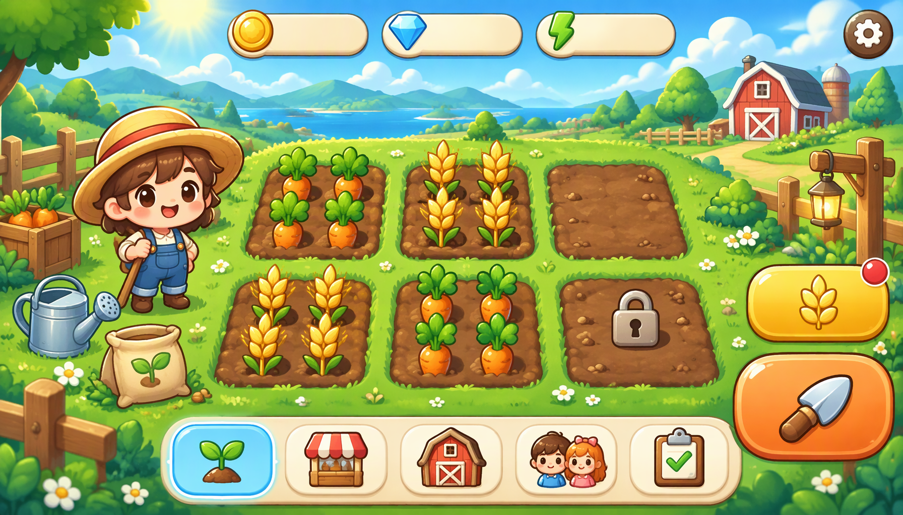

# open-assets

**English** | [中文](README.zh-CN.md)

> **A free, agent-first game UI asset library.**
> Every pack here is **free** to use, modify and ship commercially — artwork under
> [CC-BY-4.0](LICENSE-ASSETS) (attribution), code under [MIT](LICENSE).
> The repository is **agent-first**: a machine-readable catalog, deterministic
> per-project manifests and stable paths let agents discover, fetch and integrate
> assets without scraping or guesswork. Humans get a visual gallery on top.

[**Browse the gallery**](https://kaying-ai.github.io/open-assets/) ·
[`catalog.json`](catalog.json) ·
[`AGENTS.md`](AGENTS.md) ·
[License](#license)

- **Free & open** — no paywall, no sign-up; CC-BY-4.0 artwork + MIT code.
- **Agent-first** — `catalog.json` → `project.json` → `manifest.json` → engine JSON is a stable, documented consumption chain (see [`AGENTS.md`](AGENTS.md)).
- **Self-contained packs** — each `projects/<id>/` carries pages, sprites, atlas, tokens, engine handoffs and a browsable catalog.
- **Reproducible** — contracts, generation prompts and deterministic render source ship with every pack.

## For agents — how to use

1. **Discover:** `GET` [`catalog.json`](catalog.json) (or `https://raw.githubusercontent.com/kaying-ai/open-assets/main/catalog.json`). Filter `projects[]` by `tags`, `platform`, `ratio`.
2. **Inspect:** read `projects/<id>/project.json` (intro, counts, version, entry points, `resources` map).
3. **Load assets:** read `projects/<id>/exports/web/manifest.json` — the authoritative page list and atlas sprite map (`region [x,y,w,h]`, `pivot`, `slice {type,margins}`, `state`). Pair with `assets/atlases/ui-main.png`.
4. **Integrate:** consume `projects/<id>/exports/<engine>/ui-main.json` (`godot | unity | cocos | generic | taptap-maker`) or link `exports/web/tokens.css` for web. Wire both `default` and `pressed` sprites for every control.
5. **Attribute:** retain the CC-BY-4.0 credit when redistributing artwork.

```bash
curl -s https://raw.githubusercontent.com/kaying-ai/open-assets/main/catalog.json
curl -s https://raw.githubusercontent.com/kaying-ai/open-assets/main/projects/happy-farm/exports/web/manifest.json
```

Full consumption contract: [`AGENTS.md`](AGENTS.md).

## For humans — how to use

1. Open the [gallery](https://kaying-ai.github.io/open-assets/) (or `index.html` in a clone); search or filter by tag / platform; switch EN/中文.
2. Click a project to open its asset catalog (`projects/<id>/index.html`) — page visuals and every component on transparent backgrounds, with state variants.
3. Download what you need: individual PNGs, the sprite ZIP (`packages/*.zip`), or the packed atlas (`assets/atlases/`).
4. Import into your engine using the matching `exports/<engine>/ui-main.json` + atlas JSON (9-slice margins included), or link `exports/web/tokens.css` for a web build. The per-project README explains layout, states and safe areas.
5. Credit "open-assets by kaying-ai" (CC-BY-4.0) and note any changes.

## Asset catalog

Per-project list — intro, module effect images and asset inventory — regenerated by
`scripts/build-catalog.mjs`. Do not edit inside the markers.

<!-- catalog:start -->
| Preview | Project | Intro | Effect images | Assets | Links |
|---|---|---|---|---|---|
|  | [**happy-farm**](projects/happy-farm/) Happy Farm Pastoral | A cozy chibi-cartoon farm UI kit: planting/harvest core loop, shop, barn, social, tasks and settings, with two-state controls and 9-slice panels. | 6 | 30 comp / 37 sprites | [catalog](projects/happy-farm/index.html) · [README](projects/happy-farm/README.md) · [manifest](projects/happy-farm/exports/web/manifest.json) |

### happy-farm — Happy Farm Pastoral

A cozy chibi-cartoon farm UI kit: planting/harvest core loop, shop, barn, social, tasks and settings, with two-state controls and 9-slice panels.

**Specs:** mobile-landscape · 16:9 · 1792×1024 · Q版卡通田园 · v1.0.0 · CC-BY-4.0

**Module effect images (6):**

| Module | Effect image |
|---|---|
| farm 农田主页 | [farm-v1.png](projects/happy-farm/assets/pages/farm-v1.png) |
| shop 商店 | [shop-v1.png](projects/happy-farm/assets/pages/shop-v1.png) |
| barn 仓库 | [barn-v1.png](projects/happy-farm/assets/pages/barn-v1.png) |
| social 好友邻居 | [social-v1.png](projects/happy-farm/assets/pages/social-v1.png) |
| task 任务成就 | [task-v1.png](projects/happy-farm/assets/pages/task-v1.png) |
| settings 设置 | [settings-v1.png](projects/happy-farm/assets/pages/settings-v1.png) |

**Asset inventory:**
- 30 components (37 state sprites; clickable controls ship default + pressed)
- sprite sheet + 37 split element PNGs + sprite-manifest + ZIP package
- texture atlas 2048×2048 (ui-main.png + ui-main.json, with 9-slice)
- 5 engine handoffs (cocos / generic / godot / taptap-maker / unity)
- web design tokens tokens.css + manifest.json

**Links:** [browse](projects/happy-farm/index.html) · [README](projects/happy-farm/README.md) · [manifest](projects/happy-farm/exports/web/manifest.json) · [sprite zip](projects/happy-farm/packages/ui-components-png.zip)
<!-- catalog:end -->

## For agents — contribute a new pack via PR

New artwork is welcome. Follow this loop (details in [`docs/MAINTAINING.md`](docs/MAINTAINING.md)):

```bash
# 1. fork on GitHub, then clone your fork and branch
git clone git@github.com:<you>/open-assets.git && cd open-assets
git checkout -b add/<project-id>

# 2. prepare a kui spec project (or any pack with the same layout), then publish it
node scripts/publish-project.mjs /path/to/specs/<id> --id <id> \
  --title-zh "<中文名>" --desc-en "<one-line intro>" --desc-zh "<一句话简介>"

# 3. regenerate the browsing surface (gallery + catalog.json + README tables)
node scripts/build-catalog.mjs

# 4. self-check, commit, push, open PR
git status --short          # must NOT contain node_modules / _detect / _preview
git add -A && git commit -m "add <id> UI pack"
git push -u origin add/<id>
gh pr create --title "add <id> UI pack" --fill
```

**PR checklist** (also in [`.github/pull_request_template.md`](.github/pull_request_template.md)):

- [ ] Artwork is yours / CC-BY-4.0-compatible; attribution retained.
- [ ] `projects/<id>/project.json` present; intro, counts, ratio, resolution, tags correct.
- [ ] `catalog.json`, root `index.html` and both README catalog blocks regenerated.
- [ ] No `node_modules/`, `_detect/`, `_preview*` or other scratch committed.
- [ ] Size budget respected (pack ≲ 50 MB; each page hero ≲ 3 MB); no Git LFS.
- [ ] Clickable controls ship `default` + `pressed`; atlas 9-slice margins leave a stretchable center.
- [ ] Gallery shows the new card and its images load on GitHub Pages.

Maintainers merge → Pages rebuilds automatically → the pack is live.

## Repository layout

```text
open-assets/
├─ index.html              # unified browsing gallery (GitHub Pages entry)
├─ catalog.json            # machine-readable index of all projects
├─ README.md / README.zh-CN.md
├─ LICENSE / LICENSE-ASSETS
├─ AGENTS.md               # agent consumption contract
├─ .github/pull_request_template.md
├─ projects/<kebab-id>/    # one self-contained asset pack per project
│  ├─ project.json         # metadata + intro + counts + resources
│  ├─ index.html / result.html
│  ├─ assets/              # pages / components / sprites / atlases
│  ├─ exports/             # godot / unity / cocos / generic / taptap-maker / web
│  ├─ contracts/ prompts/ docs/ render/ packages/
├─ scripts/                # publish-project.mjs · build-catalog.mjs
└─ docs/MAINTAINING.md     # add / update / deprecate workflow
```

## License

- Artwork & design data: [CC-BY-4.0](LICENSE-ASSETS) — free to share/adapt, including commercially, with attribution.
- Code & scripts: [MIT](LICENSE).