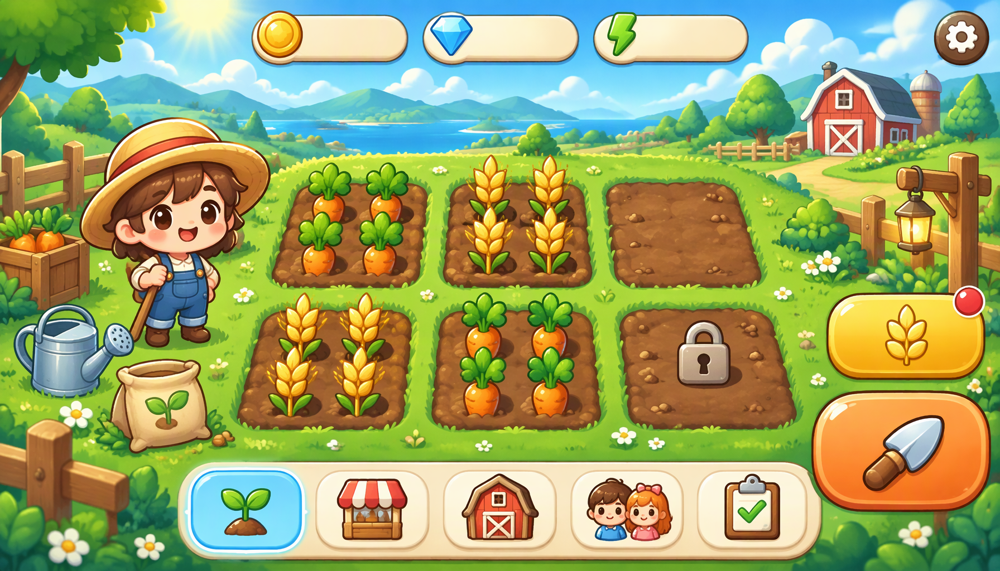
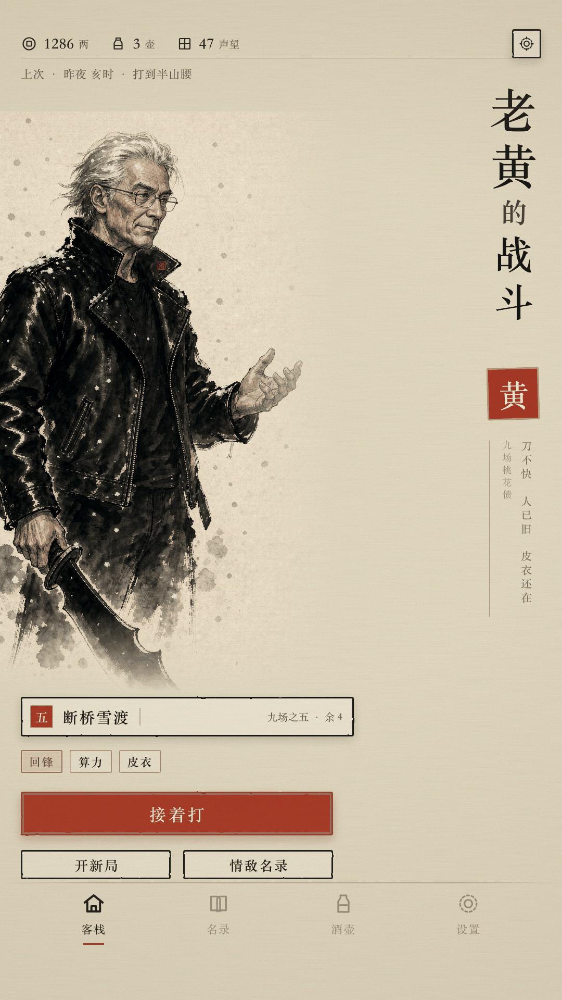

# open-assets

[English](README.md) | **中文**

> **一个免费、Agent 优先的游戏 UI 素材库。**
> 这里的每个资产包都**免费**，可自由使用、修改并商用 —— 美术采用
> [CC-BY-4.0](LICENSE-ASSETS)（需署名），代码采用 [MIT](LICENSE)。
> 本仓库 **Agent 优先**：机器可读总索引、确定性的单项目清单与稳定路径，
> 让 Agent 无需爬取或猜测即可发现、拉取并集成素材；人类则在其上获得可视化画廊。

[**浏览画廊**](https://kaying-ai.github.io/open-assets/) ·
[`catalog.json`](catalog.json) ·
[`AGENTS.md`](AGENTS.md) ·
[许可证](#许可证)

- **免费开放** —— 无付费墙、无注册；CC-BY-4.0 美术 + MIT 代码。
- **Agent 优先** —— `catalog.json` → `project.json` → `manifest.json` → 引擎 JSON 是稳定、有文档的消费链路（见 [`AGENTS.md`](AGENTS.md)）。
- **自包含资产包** —— 每个 `projects/<id>/` 都自带页面、精灵、图集、令牌、引擎交付与可浏览目录。
- **可复现** —— 契约、生成提示词与确定性渲染源码随每个资产包一起发布。

## 快速查找

| 想做什么 | 入口 |
|---|---|
| 浏览和搜索资产包 | [在线画廊](https://kaying-ai.github.io/open-assets/)：按项目 ID、名称或标签搜索 |
| 预览开心农场 | [资产目录](https://kaying-ai.github.io/open-assets/projects/happy-farm/) · [交互演示](https://kaying-ai.github.io/open-assets/projects/happy-farm/result.html) |
| 下载独立精灵 | [开心农场 PNG 素材包](projects/happy-farm/packages/ui-components-png.zip) |
| 接入游戏引擎 | [引擎导出说明](projects/happy-farm/exports/) · [Web 清单](projects/happy-farm/exports/web/manifest.json) |
| 通过程序检索 | [catalog.json](catalog.json) · [Agent 使用指南](AGENTS.md) |

目前收录 **开心农场（Happy Farm）**，适用于横屏移动游戏的温馨卡通农场 UI。目录记录了 6 张页面、30 个组件、37 个精灵和 5 种引擎交付格式。PNG、图集和清单是可集成的素材，**并非完整可玩的游戏**。

## 面向 Agent —— 如何使用

1. **发现：** `GET` [`catalog.json`](catalog.json)（或 `https://raw.githubusercontent.com/kaying-ai/open-assets/main/catalog.json`）。按 `tags`、`platform`、`ratio` 过滤 `projects[]`。
2. **查看：** 读 `projects/<id>/project.json`（简介、计数、版本、入口、`resources` 映射）。
3. **加载素材：** 读 `projects/<id>/exports/web/manifest.json` —— 权威页面列表与图集精灵表（`region [x,y,w,h]`、`pivot`、`slice {type,margins}`、`state`）。与 `assets/atlases/ui-main.png` 配套使用。
4. **集成：** 消费 `projects/<id>/exports/<engine>/ui-main.json`（`godot | unity | cocos | generic | taptap-maker`），或为 web 引用 `exports/web/tokens.css`。每个控件都要同时接线 `default` 与 `pressed` 两态精灵。
5. **署名：** 再分发美术时保留 CC-BY-4.0 署名。

```bash
curl -s https://raw.githubusercontent.com/kaying-ai/open-assets/main/catalog.json
curl -s https://raw.githubusercontent.com/kaying-ai/open-assets/main/projects/happy-farm/exports/web/manifest.json
```

完整消费契约见 [`AGENTS.md`](AGENTS.md)。

## 面向人 —— 如何使用

1. 打开[画廊](https://kaying-ai.github.io/open-assets/)（或克隆后的 `index.html`）；按项目 ID、名称或标签搜索，或按标签 / 平台筛选；可切换 EN/中文。
2. 点击项目打开其资产目录（`projects/<id>/index.html`）—— 页面视觉与全部透明底组件精灵，含状态变体。
3. 按需下载：单个 PNG、精灵 ZIP（`packages/*.zip`），或打包图集（`assets/atlases/`）。
4. 用匹配的 `exports/<engine>/ui-main.json` + 图集 JSON（含 9-slice 边距）导入引擎，或为 web 构建引用 `exports/web/tokens.css`。单项目 README 说明布局、状态与安全区。
5. 署名「open-assets by kaying-ai」；请按照 [LICENSE-ASSETS](LICENSE-ASSETS) 保留署名与许可信息并注明改动。

## 素材总表

单项目列表 —— 简介、发布者、效果图与素材数量 —— 由 `scripts/build-catalog.mjs` 自动再生成。
新资产包发布后会追加到此列表。请勿在标记之间手工编辑。

<!-- catalog:start -->
| 预览 | 项目 | 发布者 | 简介 | 模块效果图 | 素材 | 入口 |
|---|---|---|---|---|---|---|
|  | [**happy-farm**](projects/happy-farm/) 开心农场 | [kaying-ai](https://github.com/kaying-ai) | Q版卡通田园农场 UI 套件：种植/收获核心循环，含商店、仓库、社交、任务与设置；控件两态、面板 9-slice。 | 6 | 30 组件 / 37 精灵 | [目录](projects/happy-farm/index.html) · [README](projects/happy-farm/README.md) · [manifest](projects/happy-farm/exports/web/manifest.json) |
|  | [**laohuang-battle**](projects/laohuang-battle/) 老黄的战斗 | [kaying-ai](https://github.com/kaying-ai) | 中式水墨硬核肉鸽 UI：黑皮衣银发刀客为九场桃花债雪夜登山——山道路线图、情敌登场、关底血条与战后三选一。 | 7 | 9 组件 / 15 精灵 | [目录](projects/laohuang-battle/index.html) · [README](projects/laohuang-battle/README.md) · [manifest](projects/laohuang-battle/exports/web/manifest.json) |
<!-- catalog:end -->

## 面向 Agent —— 通过 PR 贡献新资产包

欢迎新美术。按以下流程提交（细节见 [`docs/MAINTAINING.md`](docs/MAINTAINING.md)）：

```bash
# 1. 在 GitHub 上 fork，然后克隆你的 fork 并建分支
git clone git@github.com:<you>/open-assets.git && cd open-assets
git checkout -b add/<project-id>

# 2. 准备一个 kui spec 项目（或任何同布局的资产包），然后发布它
node scripts/publish-project.mjs /path/to/specs/<id> --id <id> \
  --title-zh "<中文名>" --publisher <your-github-handle> \
  --desc-en "<one-line intro>" --desc-zh "<一句话简介>"

# 3. 重新生成浏览面（画廊 + catalog.json + README 表格）
node scripts/build-catalog.mjs

# 4. 自检、提交、推送、开 PR
git status --short          # 不得包含 node_modules / _detect / _preview
git add -A && git commit -m "add <id> UI pack"
git push -u origin add/<id>
gh pr create --title "add <id> UI pack" --fill
```

**PR 检查清单**（同样见 [`.github/pull_request_template.md`](.github/pull_request_template.md)）：

- [ ] 美术为你原创 / 兼容 CC-BY-4.0；保留署名。
- [ ] `projects/<id>/project.json` 存在；简介、计数、比例、分辨率、标签正确。
- [ ] `catalog.json`、根 `index.html` 与两个 README 的素材总表块已重新生成。
- [ ] 未提交 `node_modules/`、`_detect/`、`_preview*` 等临时文件。
- [ ] 遵守体积预算（资产包 ≲ 50 MB；每张页面主图 ≲ 3 MB）；不使用 Git LFS。
- [ ] 可点击控件含 `default` + `pressed`；图集 9-slice 边距保留可拉伸中心。
- [ ] 画廊显示新卡片，且图片在 GitHub Pages 上能加载。

维护者合并 → Pages 自动重建 → 资产包上线。

## 仓库结构

```text
open-assets/
├─ index.html              # 统一浏览画廊（GitHub Pages 入口）
├─ catalog.json            # 全部项目的机器可读索引
├─ README.md / README.zh-CN.md
├─ LICENSE / LICENSE-ASSETS
├─ AGENTS.md               # agent 消费契约
├─ .github/pull_request_template.md
├─ projects/<kebab-id>/    # 每项目一个自包含资产包
│  ├─ project.json         # 元数据 + 简介 + 计数 + resources
│  ├─ index.html / result.html
│  ├─ assets/              # pages / components / sprites / atlases
│  ├─ exports/             # godot / unity / cocos / generic / taptap-maker / web
│  ├─ contracts/ prompts/ docs/ render/ packages/
├─ scripts/                # publish-project.mjs · build-catalog.mjs
└─ docs/MAINTAINING.md     # 新增 / 更新 / 弃用 流程
```

## 许可证

- 美术与设计数据：[CC-BY-4.0](LICENSE-ASSETS) —— 署名即可自由分享/改编，含商用。
- 代码与脚本：[MIT](LICENSE)。